# Architecture

## Two paths, one model

```mermaid
flowchart TB
    subgraph Browser runtime
        B1[Web page] --> B2[wasm-pack JS glue]
        B2 --> B3[Rust predict&#40;data, shape&#41;]
        B3 --> B4[tract-onnx plan]
        B4 --> B5[Float32 output]
    end

    subgraph Server runtime
        S1[POST /predict] --> S2[GatewayService]
        S2 --> S3[InferenceRequest.from_payload]
        S3 --> S4{valid?}
        S4 -->|no| S5[400 / 413]
        S4 -->|yes| S6[batches&#40;max_batch&#41;]
        S6 --> S7[Backend.infer]
        S7 -->|HTTP v2| S8[Triton]
        S7 -->|demo| S9[DemoBackend]
        S2 --> S10[Prometheus metrics]
    end
```



## Python package

### `config.py`

- `GatewayConfig` — immutable, validated runtime configuration.
- `GatewayConfig.from_env()` — reads `TRITON_URL`, `TRITON_MODEL`, `TRITON_TIMEOUT`, `MAX_BATCH_SIZE`, `MAX_REQUEST_ELEMENTS`, `ALLOW_ORIGINS`, `TRITON_ENABLED`.
- `parse_model_config()` — scans `config.pbtxt`, balancing nested `dims: [...]` brackets, returns `ModelSpec` with `TensorSpec` inputs/outputs.

### `validation.py`

`InferenceRequest.from_payload()` enforces:

- payload is an object;
- `input_shape` is a non-empty list of positive integers (booleans rejected);
- `input_data` is a list of finite numbers (booleans rejected);
- `len(data) == product(shape)`;
- `product(shape) <= max_elements` (otherwise 413).

`InferenceRequest.batches(n)` splits along the first dimension, preserving row-major order.

### `backends.py`

- `DemoBackend` — average-pools the flattened tensor into `output_size` buckets and applies a stable softmax.
- `TritonHTTPBackend` — posts to `/v2/models/{model}/infer` and probes `/v2/health/ready` using `urllib`.
- `BackendError` — transport/protocol failure, mapped to 503.

Both satisfy the `Backend` protocol, so the service does not know which is in use.

### `metrics.py`

`Metrics` keeps counters and histogram observations and renders Prometheus text:

```text
# TYPE inference_requests_total counter
inference_requests_total 3
# TYPE inference_latency_seconds histogram
inference_latency_seconds_bucket{le="0.005"} 0
...
inference_latency_seconds_bucket{le="+Inf"} 3
inference_latency_seconds_count 3
inference_latency_seconds_sum 0.042
```

### `service.py`

Orchestrates: increment request counter → validate → batch → infer → observe latency/batch size. Errors are converted to `PredictionResult`, never raised to the HTTP layer.

| Failure | Status |
|---|---|
| Validation | 400 |
| Element budget exceeded | 413 |
| Backend unavailable / protocol error | 503 |
| Unexpected backend bug | 500 |
| Success | 200 |

### `app/main.py`

Thin FastAPI adapter with CORS, `/predict`, `/health`, `/ready`, `/model`, `/metrics`. The backend is selected by `TRITON_ENABLED`; the demo backend is the default.

## Rust/WASM path

`src/lib.rs` exposes:

```rust
#[wasm_bindgen]
pub struct OnnxModel { ... }

impl OnnxModel {
    pub fn new(model_data: &[u8]) -> Result<OnnxModel, JsValue>;
    pub fn predict(&self, input_data: &[f32], input_shape: &[usize]) -> Result<Vec<f32>, JsValue>;
}
```

`shape_product()` validates empty shapes, zero dimensions, and `usize` overflow before tensor creation. Four native tests cover it.

## Deployment topology

```text
docker compose
├── app          FastAPI + triton_gateway   :8000
├── triton       Triton Inference Server    :8001 -> :8000, metrics :8002
├── prometheus   scrapes app:8000 & triton:8002
└── grafana      dashboards                 :3000
```

`prometheus.yml` uses container DNS names, not `localhost`; this was a bug in the original compose file and is fixed.

## Invariants

| Invariant | Enforcement |
|---|---|
| No invalid tensor reaches a backend | validation happens before batching |
| Batching never exceeds `max_batch_size` | `InferenceRequest.batches` |
| A backend bug cannot crash the API | `except Exception` → 500 |
| Metrics stay valid Prometheus text | name regex, sorted output, `+Inf` bucket |
| Readiness reflects the backend | `Backend.health()` |
| WASM input shape matches data | `shape_product()` check |

See [TESTING.md](./TESTING.md) and [docs/DESIGN_DECISIONS.md](./docs/DESIGN_DECISIONS.md).
