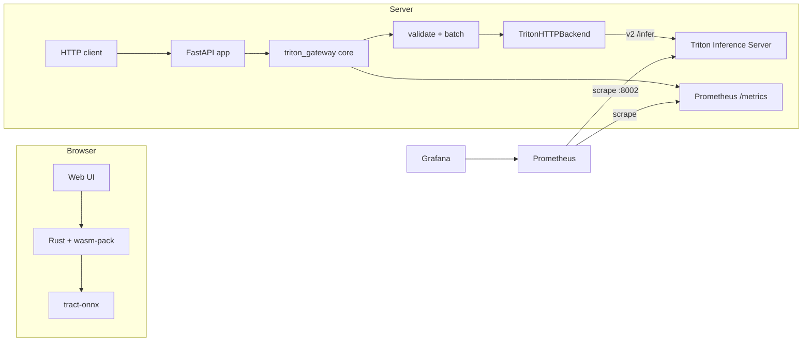

# ONNX · Rust · WebAssembly · Triton · Prometheus · Grafana

**One inference stack, two runtimes: ONNX inference compiled to WebAssembly for the browser, and a validated Triton gateway for the server — with first-class batching, readiness probes, Prometheus metrics, and 100% branch coverage of the gateway core.**

[](https://github.com/MrKyaw/Onnx_Rust_Web_Assembly_Triton_Promethus_Grafana/actions/workflows/ci.yml)
[](https://www.python.org/)
[](https://www.rust-lang.org/)
[](./TESTING.md)
[](./TESTING.md)
[](./TESTING.md)
[](./license.txt)

---

## Why this repository exists

Most “ONNX in production” demos stop at a notebook. This one covers the unglamorous parts that decide whether inference survives contact with users:

| Concern | Implementation |
|---|---|
| **Client-side inference** | `tract-onnx` compiled to `wasm32-unknown-unknown`, packaged with `wasm-pack` for the browser. |
| **Server-side inference** | Triton v2 HTTP protocol via a stdlib-only client (no `tritonclient` dependency). |
| **Input safety** | Shape/data validation, finite-number checks, element budgets, typed 400/413 errors. |
| **Efficiency** | Deterministic first-dimension batching before calls reach Triton. |
| **Operations** | `/health`, `/ready`, `/metrics`, `/model`; Prometheus text exposition; Grafana-ready. |
| **Testability** | 100% line/branch coverage of the gateway core without a GPU, container, or network. |

---

## Architecture



The Python core is transport-agnostic. `app/main.py` is a thin FastAPI adapter; `src/lib.rs` is the independent browser path.

---

## What's inside

```
Onnx_Rust_Web_Assembly_Triton_Promethus_Grafana/
├── triton_gateway/                # ⭐ tested, stdlib-only gateway core
│   ├── config.py                 # env config + Triton config.pbtxt parser
│   ├── validation.py             # shape/data validation and batching
│   ├── backends.py               # Triton v2 HTTP client + demo backend
│   ├── metrics.py                # Prometheus counter/histogram exposition
│   ├── service.py                # orchestration, readiness, error mapping
│   └── __main__.py               # CLI demo
├── app/main.py                   # FastAPI adapter
├── src/lib.rs                    # Rust/WASM ONNX inference (4 native tests)
├── tests/                        # 83 Python tests + 6 HTTP contract tests
├── model_repository/onnx_wasm_model/config.pbtxt
├── docker-compose.yml            # app + Triton + Prometheus + Grafana
├── prometheus.yml
├── ARCHITECTURE.md
├── TESTING.md
└── docs/OPERATIONS.md
```

---

## 60-second quickstart

```bash
git clone https://github.com/MrKyaw/Onnx_Rust_Web_Assembly_Triton_Promethus_Grafana.git
cd Onnx_Rust_Web_Assembly_Triton_Promethus_Grafana
python -m pip install -e ".[dev]"

python -m triton_gateway --demo
pytest --cov=triton_gateway --cov-branch --cov-report=term-missing
cargo test
```

**Verified:**

```text
83 passed  (77 core + 6 HTTP contract)
TOTAL  403 statements  102 branches  100% coverage

cargo test: 4 passed
wasm-pack build --target web --release: success
```

No GPU, container, or API key is required for any of the above.

---

## Usage

### CLI: validate, batch, infer, expose metrics

```bash
python -m triton_gateway --demo --json
```

```json
{
  "result": {
    "success": true,
    "output": [0.0124, 0.0337, 0.0917, 0.2492, 0.6130],
    "status_code": 200,
    "elapsed_ms": 0.047,
    "batches": 1
  },
  "health": {"status": "ok", "model": "onnx_wasm_model"},
  "ready": {"status": "ready", "model": "onnx_wasm_model"}
}
```

Output values are deterministic for the built-in tensor; `elapsed_ms` varies by machine.

### Parse a real Triton model config

```bash
python -m triton_gateway --model-config model_repository/onnx_wasm_model/config.pbtxt
```

### HTTP API

```bash
pip install -e ".[live]"
uvicorn app.main:app --port 8000
```

```bash
curl -s localhost:8000/predict \
  -H 'content-type: application/json' \
  -d '{"input_data":[0.1,0.2,0.3,0.4],"input_shape":[1,1,2,2]}' | jq
```

| Endpoint | Purpose |
|---|---|
| `POST /predict` | Validated inference; returns 200/400/413/500/503. |
| `GET /health` | Liveness and model identity. |
| `GET /ready` | Backend readiness (503 when Triton is down). |
| `GET /model` | Effective gateway configuration. |
| `GET /metrics` | Prometheus text exposition. |

### Full stack

```bash
docker compose up --build
# gateway   http://localhost:8000
# Triton    http://localhost:8001
# Prometheus http://localhost:9090
# Grafana    http://localhost:3000 (admin/admin)
```

Triton is configured for the `onnx_wasm_model` repository. Set `TRITON_ENABLED=false` to run the gateway with the deterministic demo backend.

---

## Test evidence

| Suite | Result |
|---|---|
| Python core (`tests/test_triton_gateway.py`) | 77 passed |
| FastAPI contract (`tests/test_app.py`) | 6 passed |
| Coverage (`triton_gateway`, branch) | **100%** (403 statements, 102 branches) |
| Rust (`cargo test`) | 4 passed |
| WASM (`wasm-pack build --target web --release`) | success |

Details: **[TESTING.md](./TESTING.md)**.

---

## Engineering decisions

1. **Stdlib-only core.** `urllib`, `json`, `dataclasses`, `math` are enough. The live adapter adds FastAPI only.
2. **Validate before batching.** Malformed shapes never reach Triton and never consume a slot.
3. **Batch on the first dimension.** Mirrors Triton's `max_batch_size` semantics and is deterministic.
4. **Explicit error mapping.** 400 invalid, 413 too large, 503 backend unavailable, 500 unexpected; the API never returns a 200 with `"success": false`.
5. **Hand-rolled Prometheus exposition.** Counters and histograms are rendered with stable ordering and `+Inf` buckets.
6. **Readiness is a backend probe.** `/health` is liveness; `/ready` reflects Triton availability.
7. **No dead dependencies.** Removed unused Liquid templates and `wee_alloc`; the WASM build now succeeds.
8. **Real config parsing.** `config.pbtxt` is scanned with balanced brackets, not a fragile regex.

More: [ARCHITECTURE.md](./ARCHITECTURE.md) · [docs/DESIGN_DECISIONS.md](./docs/DESIGN_DECISIONS.md) · [docs/OPERATIONS.md](./docs/OPERATIONS.md).

---

## Honest boundaries

- `tract-onnx` supports a subset of ONNX operators; verify your model before shipping to the browser.
- The demo backend is a deterministic softmax placeholder, not a trained model.
- The Docker stack requires pulling NVIDIA Triton and works best with an NVIDIA GPU; the gateway itself runs on CPU.
- Rust/WASM build time is dominated by `tract` (minutes on a cold cache).

---

## Recruiter snapshot

- **Role fit:** ML platform / inference infrastructure / MLOps / systems engineer.
- **Signals:** cross-language delivery (Rust → WASM, Python → HTTP), protocol-level work (Triton v2), observability, validation, batching, CI, documentation.
- **Stack:** Rust, WebAssembly, ONNX, Triton, FastAPI, Prometheus, Grafana, Docker Compose, pytest, GitHub Actions.
- **Evaluate in one command:** `pytest --cov=triton_gateway --cov-branch && cargo test`.

---

## Author

**Kyaw Kyaw Oo** — AI/software engineer focused on reliable inference and agentic systems.
[GitHub](https://github.com/MrKyaw) · [Email](mailto:kyaw.tech@gmail.com)

Licensed under the MIT License. See [license.txt](./license.txt).
